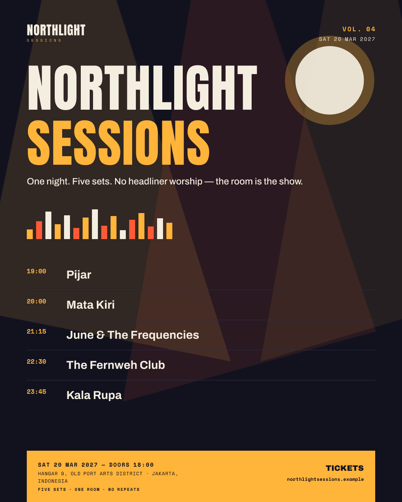
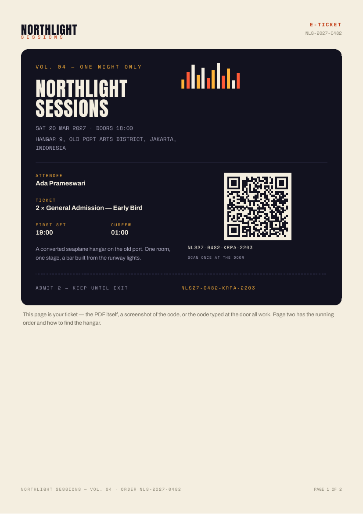
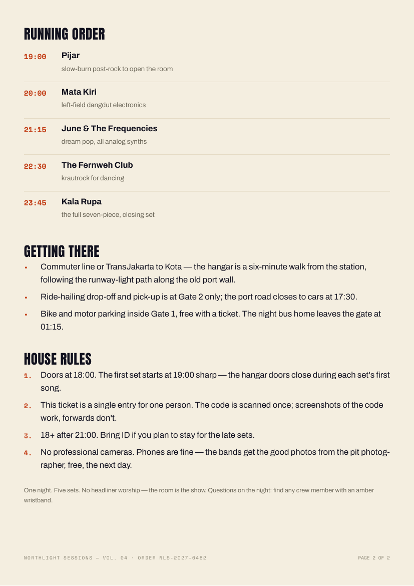
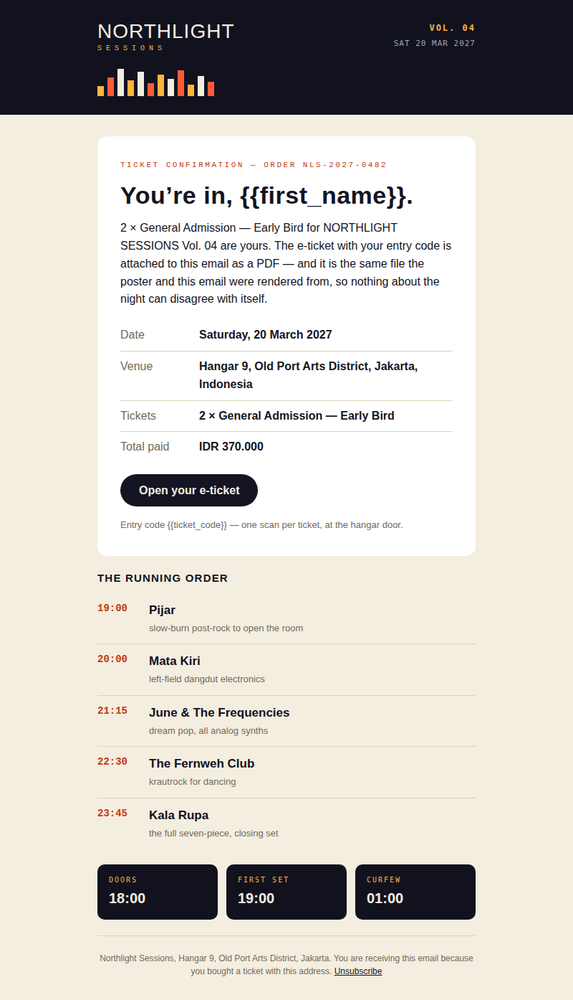

# Northlight Sessions — a one-night gig kit for Hyper Elements

**One event, one data file, one theme — three templates.** A poster (Canvas), an e-ticket (Document → PDF) and a confirmation email (Email), all rendered from the same source of truth, so the night can never disagree with itself: change the date in `src/event.ts` and the poster on the wall, the ticket in the inbox and the email above it all change together.

Built for the [Hyper Elements Template Challenge](https://github.com/hyper-elements/hyper-elements/discussions).



## The night

Northlight Sessions Vol. 04 is a fictional one-night indie gig in a converted seaplane hangar in Jakarta: five sets, no headliner, doors at 18:00. The kit is everything the night needs to sell and run itself:

| Template | Root | Output | What it's for |
| --- | --- | --- | --- |
| [`src/poster.tsx`](src/poster.tsx) | `Canvas` 1080×1350 | `out/poster.png`, `out/poster.svg` | The poster / social card |
| [`src/ticket.tsx`](src/ticket.tsx) | `Document` A4, 2 pages | `out/ticket.pdf`, `out/ticket.html` | The e-ticket attached to the email |
| [`src/email.tsx`](src/email.tsx) | `Email` 600px | `out/email.html`, `out/email.txt` + 7 client previews | The confirmation, sent on purchase |

## The ticket's QR code is real

The QR on the e-ticket is not an image. The `qrcode` library supplies the module matrix and every dark module is drawn as an `Svg` `Rect` (see `QrCode` in [`src/components.tsx`](src/components.tsx)), so the code is part of the template and renders identically in the print HTML and the PDF. It encodes the ticket URL — decode `out/ticket.pdf` with any scanner app and check.




## How Hyper Elements is used

- **One theme, three roots.** [`src/theme.ts`](src/theme.ts) is a single `defineTheme` — palette, type system (Anton / Archivo / Space Mono), component defaults for `Heading` and `Button`, and named styles (`card`, `eyebrow`) — passed to the `Email`, `Document` and `Canvas` roots alike. Templates pull colours with `token("colors.amber")`; nothing is hard-coded twice.
- **Shared components across formats.** [`src/components.tsx`](src/components.tsx) holds the parts every surface needs: the wordmark, the running-order list (one component, three sizes), and the equalizer — the night's motif, a row of level-meter bars built from plain `Column`s in a `Row`. Because it is layout, not `Svg`, it is the one piece of artwork that survives every email client, where `Svg` doesn't exist.
- **Email, done properly.** Merge tags (`first_name`, `ticket_code`) for personalisation, a `Table` for the order summary, a themed `Button` with a hover state, and validation with the `@hyper-elements/email-clients` plugin — `render.tsx` also writes per-client previews (Gmail, Apple Mail, Outlook…) into `out/clients/`. The design uses colour bands and the equalizer instead of images, so it holds up with images off.
- **A Document that paginates.** `PageBreak`, `PageFooter` with `PageNumber` / `PageNumber total`, and a perforated stub on the ticket page. Page two is the part people actually re-open: running order, directions, house rules.
- **A Canvas with drawn artwork.** The poster layers `Svg` stage-light beams and a moon-disc under the type with `Layer` — no image assets anywhere in the kit.
- **One render pipeline.** [`render.tsx`](render.tsx) validates all three templates (the email with the email-clients plugin), then renders every output — `render()` for the email and print HTML, `renderPdf()` for the ticket, `renderImage()` for the poster — handing the PDF and image renderers the same font files as bytes. Any error diagnostic stops the build.
- **Clean checks.** `npm run check` (the Hyper Elements CLI) reports **0 errors, 0 warnings** across all three templates, including the contrast, heading-order and language lints.



## Design

Deep ink navy, warm paper, amber and coral; Anton for display, Archivo for text, Space Mono for anything that smells like a ticket stub. Small text in coral is darkened (`coralDeep`) to keep 4.5:1 contrast on light grounds — the bright coral is kept for large shapes and dark grounds, where it belongs.

## Notes from building with the beta

Two engine quirks found while building, with the workarounds used here, in case they help the team:

- `renderPdf()` measures display headings by the font's own metrics; Anton's run tight, so copy under a big Anton heading can sit on top of it in the PDF while the HTML is fine. The ticket splits its two-line title into two `Heading`s and gives the block a little bottom padding (`src/ticket.tsx`).
- In the PDF, `List` items wrap at a wider measure than the page and run past the edge. The ticket's lists are built as rows (marker column + text column) instead, which renders identically in HTML and PDF.
- The PDF/image renderers want TTF/OTF/WOFF — the kit vendors WOFF for the HTML font faces and TTF conversions of the same files for the byte-based renderers, both under `assets/fonts/`.

## Run it

```sh
npm install
npm run render   # validates everything, then writes out/
npm run check    # hyper-elements check on the three templates
npm run typecheck
```

Outputs land in `out/`: `poster.png` / `poster.svg`, `ticket.pdf` / `ticket.html`, `email.html` / `email.txt`, and the email's per-client previews in `out/clients/`.

**Make it your own night:** edit `src/event.ts` — the event, the lineup, the order — and re-run `npm run render`. All three surfaces follow. Swap the palette and fonts in `src/theme.ts` and the whole kit rebrands.

## Structure

```
src/
  event.ts       the night itself — the single source of truth
  theme.ts       the Northlight brand as one defineTheme
  components.tsx wordmark, equalizer, lineup list, Svg QR, light beams
  email.tsx      the confirmation email (Email root)
  ticket.tsx     the e-ticket (Document root)
  poster.tsx     the poster (Canvas root)
  fonts.ts       font faces for the HTML outputs
render.tsx       validate + render every output into out/
assets/fonts/    Anton, Archivo, Space Mono (WOFF for HTML, TTF for PDF/image)
preview/         the screenshots above
out/             rendered outputs (regenerated by npm run render)
```

## License

MIT — see [LICENSE](LICENSE). Fonts are Anton, Archivo and Space Mono (SIL Open Font License), via Fontsource.
